# Project 01: Airye Help Desk on AWS (osTicket)

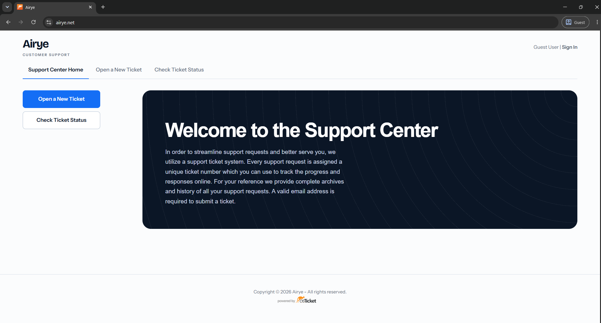

## Objective
Deploy and run a production customer support help desk on AWS with a custom domain, email-to-ticket integration, and outgoing mail signed by the domain, then redesign the customer portal and agent panel with custom CSS that works on phones.

## Architecture & Stack
* **Cloud:** AWS EC2 (Ubuntu Linux), Elastic IP, Security Group, key-based SSH access
* **Web Stack:** Apache, PHP, MySQL, osTicket 1.18
* **DNS & Email:** Cloudflare DNS, Cloudflare Email Routing, Gmail inbox (IMAP), Brevo SMTP relay
* **Automation:** `cron` job fetching incoming mail every five minutes
* **Front End:** Custom CSS (design system built on CSS variables, responsive layouts)

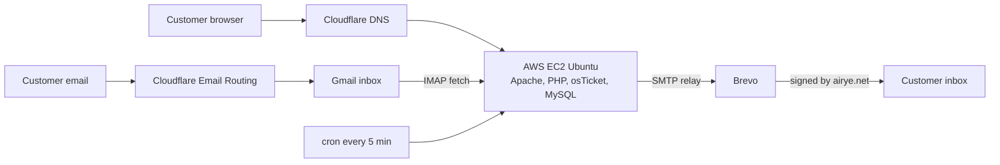

## DNS & Email Configuration Summary

| Component | Setting | Purpose |
| :--- | :--- | :--- |
| **A record** | `airye.net` → AWS Elastic IP | Points the domain at the EC2 server |
| **MX records** | Cloudflare Email Routing | Receives mail sent to the support address |
| **Routing rule** | `support@airye.net` → Gmail inbox | Forwards support mail to the inbox osTicket reads |
| **SPF record** (TXT) | Authorizes the services that send for the domain | Helps outgoing mail pass sender checks |
| **DKIM record** | Brevo signing key | Lets outgoing mail be signed by `airye.net` |
| **IMAP** | `://gmail.com`, port `993`, folder `INBOX` | Fetches new mail and turns it into tickets |
| **SMTP** | Brevo relay | Sends agent replies and ticket alerts |
| **Processed mail** | Moved to a `Processed` folder after import | Prevents duplicate tickets |

## Verification Screenshots
*(Click any section below to expand screenshots)*

<strong>1. Customer Portal (4 Screenshots)</strong> — Open ticket, check status, sign in & registration

 

  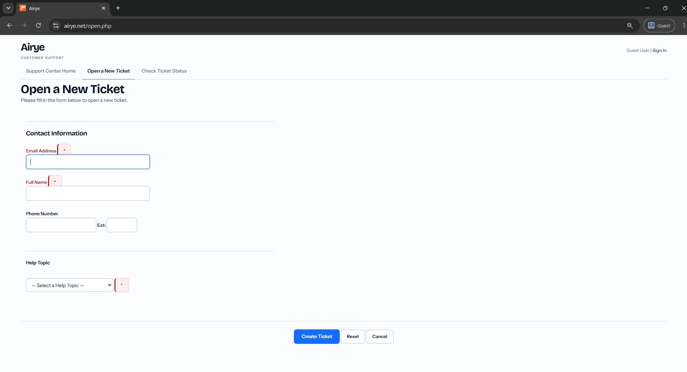
  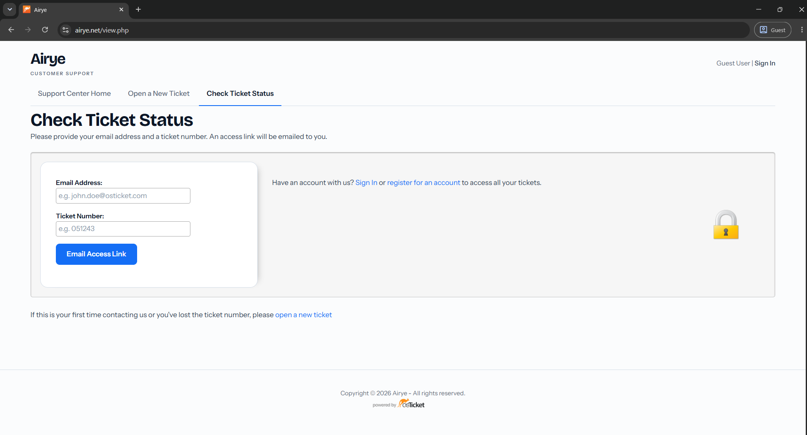
    
  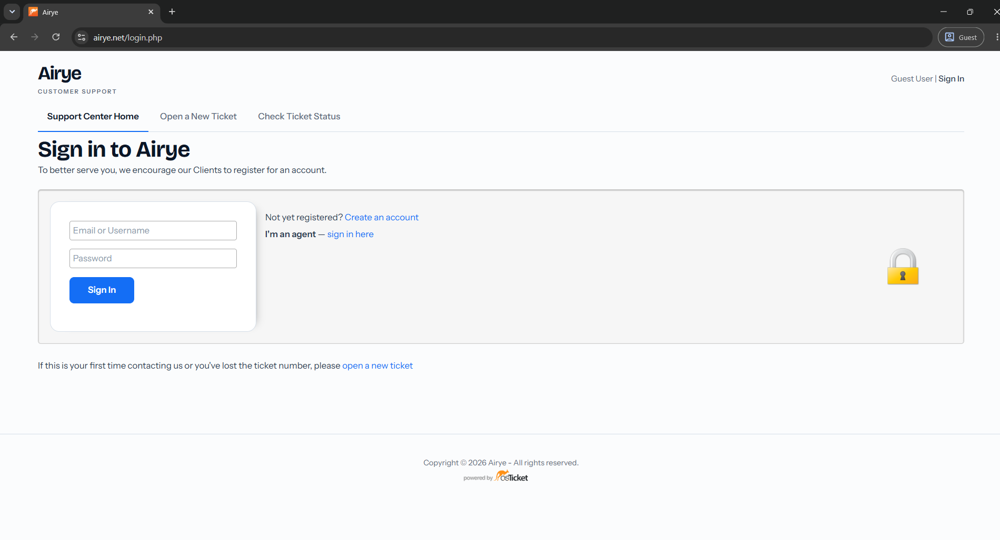
  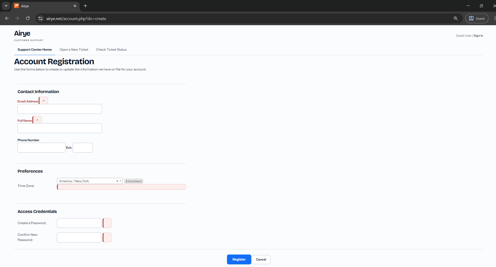

<strong>2. Email Delivery Signed by Domain (2 Screenshots)</strong> — Ticket alert & DKIM/TLS verification

 

  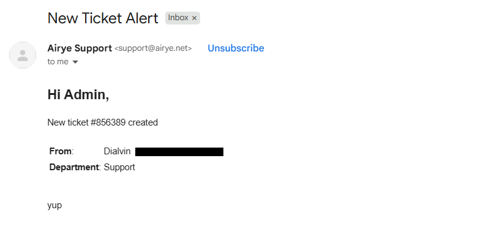
  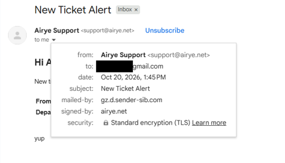

<strong>3. Agent Panel (6 Screenshots)</strong> — Login, ticket queue, replies, tasks & directories

 

  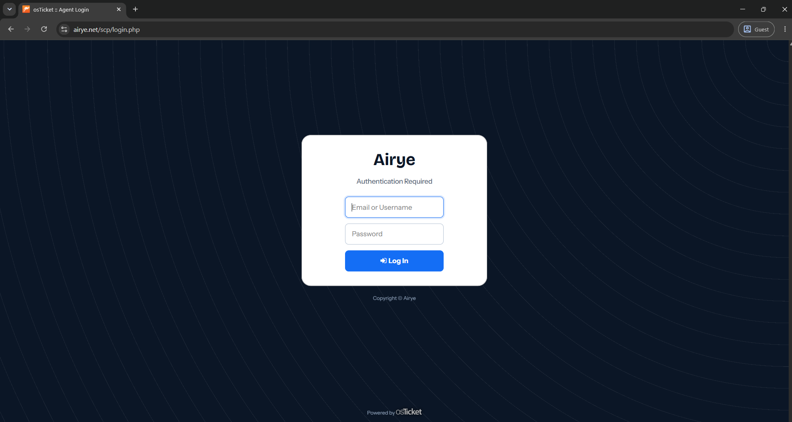
  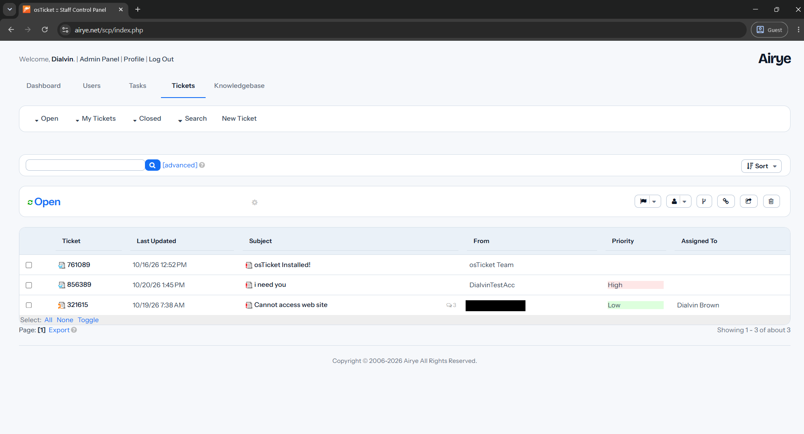
    
  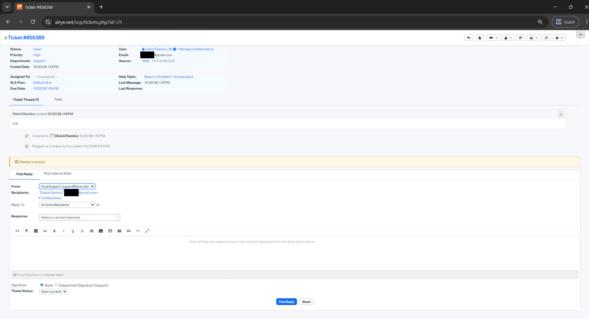
  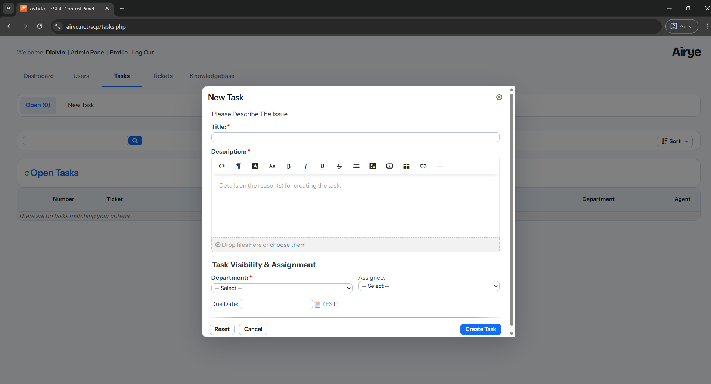
    
  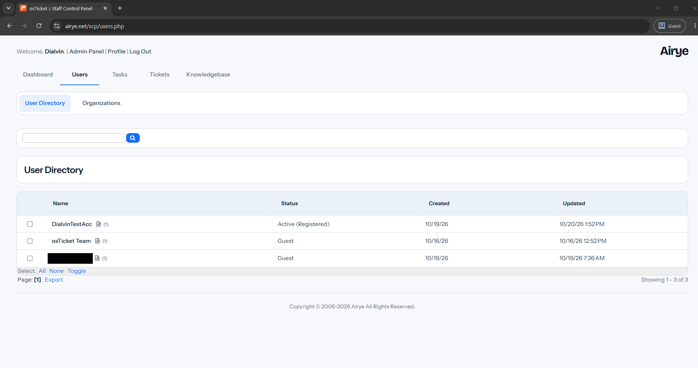
  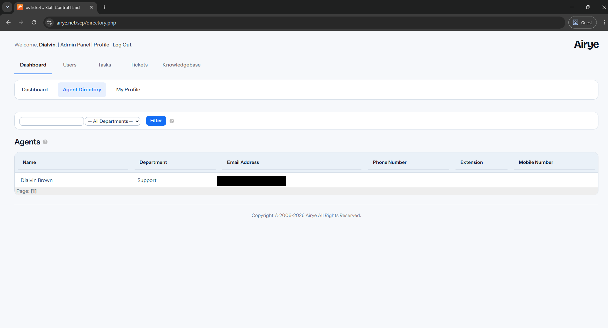

<strong>4. Mobile Responsive Layout (1 Screenshot)</strong> — Customer portal & agent panel on phone screens

 

  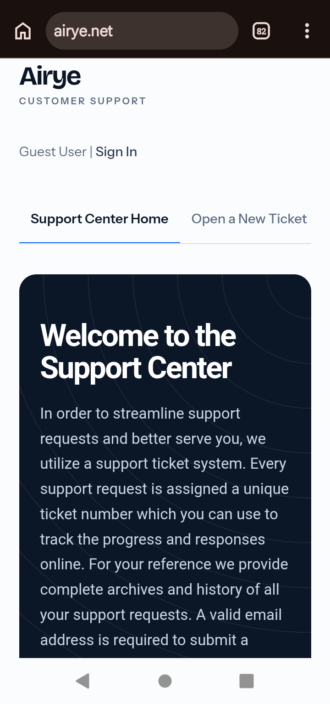

## Problems Solved

* **Server freezes (memory exhaustion):** The 1 GB instance became unreachable repeatedly. `free -h` showed about 908 MB of memory with roughly 812 MB in use and no swap. I added a 2 GB swap file and made it persistent in `/etc/fstab`, which stabilized the server.
* **Mobile login card pushed off screen:** osTicket positioned the card with a fixed negative margin, which only works at one width. I replaced it with centering that holds at any screen size.
* **Default styles overriding mine:** osTicket's own CSS and scripts fought my styles in the navigation bars and queue menu. I diagnosed them with browser developer tools and the platform's template source, then wrote targeted fixes.
* **Email setup errors:** Resolved authentication and settings errors connecting the mailbox, including a system-email conflict in the admin settings, then moved outgoing mail to Brevo so messages are signed by the domain.
* **Lost agent password:** Reset it directly in the MySQL database with a bcrypt hash, after identifying the database and table prefix from the config file.

## Key Skills Demonstrated
* **Linux Server Administration:** Deployed and maintained an Ubuntu server on AWS EC2 over SSH, including swap configuration and scheduled jobs with `cron`.
* **DNS & Email Infrastructure:** Configured Cloudflare DNS, Email Routing, MX, SPF and DKIM records, and connected IMAP and an SMTP relay for two-way email with the help desk.
* **Web Stack Troubleshooting:** Diagnosed outages and layout bugs using system tools, browser developer tools and platform source files.
* **Front-End Customization:** Built a responsive design system in CSS for a customer portal and an agent panel.
* **Database Administration:** Used MySQL to recover access to the application.

## Configuration Files
* [Customer Portal Stylesheet](./css/custom-style.css)
* [Agent Panel Stylesheet](./css/airye-scp.css)

Server credentials, SSH keys and the osTicket configuration file are intentionally not included.
